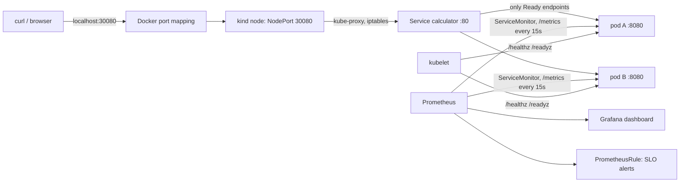

# Design decisions

The application is a stdlib-only HTTP/1.1 calculator that reads raw bytes off a
TCP socket. It holds no state between requests and calls no other service.
Most of the decisions below follow from those two facts.

## Architecture and request path



1. The client connects to `localhost:30080`. kind maps that host port into the
   node container (`deploy/kind.yaml`).
2. The NodePort Service sends the connection, through kube-proxy's iptables
   rules, to one of the **Ready** pod IPs. A pod that is failing readiness
   or terminating is removed from the endpoints and gets no new connections.
3. `server.py` parses the request, computes the answer, writes one JSON log
   line containing the trace id, updates its counters, and keeps the TCP
   connection open for the next request (keep-alive).
4. Prometheus scrapes `/metrics` on every pod. The recording rules turn the
   scraped series into SLO ratios, and the alert rules evaluate those ratios.

| Failure boundary | What contains it |
|---|---|
| One request is malformed or malicious | `BadRequest` closes only that connection. The framing rules (CL+TE, duplicate Host, size limits) stop request smuggling. |
| One client holds connections open | `MAX_CONNECTIONS=64` per pod. Extra connections get a 503 and are counted as `op="refused"`, which feeds the error SLO. |
| One process hangs or dies | The liveness probe restarts it. The second replica keeps serving in the meantime. |
| A bad release | `maxUnavailable: 0` and readiness gating keep the old pods serving. `--rollback-on-failure` reverts the release automatically. |
| A node drain | The PodDisruptionBudget (`minAvailable: 1`) blocks evicting the last pod. |
| A compromised pod | No egress, no ServiceAccount token, read-only root filesystem, no shell, non-root user, all capabilities dropped. |

There is one node, so a node failure means a full outage. That is a stated
limitation of a laptop cluster. On a multi-node cluster, the
`topologySpreadConstraints` already in the chart would spread the pods.

## Kubernetes choices

- **Deployment, not StatefulSet.** There is no state and no need for a stable
  identity, so pods are interchangeable. A StatefulSet would make rollouts
  slower and give nothing in return. If results ever had to be stored, the
  store would be a separate component and the calculator would stay stateless.
- **No volumes and no PVC**, for the same reason. The read-only root filesystem
  works because Python is told not to write `.pyc` files
  (`PYTHONDONTWRITEBYTECODE`).
- **Two probes with different meanings.** `/healthz` (liveness) asks "can the
  process still answer?", and failing it restarts the container. `/readyz`
  (readiness) asks "does it want traffic?". Readiness turns false during
  shutdown, while liveness stays true, so draining never looks like a crash. No
  startup probe: the server binds in well under a second.
- **Graceful drain.** On SIGTERM the server sets `DRAINING`. Readiness then
  fails, every response carries `Connection: close` so keep-alive clients
  reconnect to a ready pod, and the listener keeps accepting for
  `DRAIN_SECONDS` (5 s). The listener stays open because endpoint removal
  reaches kube-proxy asynchronously, and a few connections can still arrive
  after SIGTERM. Measured result: 0 failures across 661 requests during a
  rolling restart.
- **Resources.** The requests (50m CPU, 32Mi memory) are measured idle usage
  plus some headroom, and they are what the scheduler reserves. The 128Mi
  memory limit turns a leak into an OOM restart instead of node pressure.
  There is no CPU limit, on purpose: CFS throttling adds tail latency to a
  latency SLO, and on a single-tenant cluster there is no neighbour to protect.
  Trivy flags this as KSV-0011 (LOW), and the flag is accepted for that reason.
- **No HPA.** Load is a single person. An HPA needs metrics-server, and
  scaling a 0.1 ms handler on CPU would only react to noise. If I added
  one, it would scale on `calc_open_connections` (the real saturation signal,
  because of the 64-connection ceiling) through a custom metrics adapter.
- **NodePort, not Ingress.** There is one service, no hostnames and no TLS on
  a laptop, so an ingress controller would add a component without adding a
  capability. In the cloud this becomes a LoadBalancer Service, or an Ingress
  that terminates TLS.

## Deployment configuration

There is a single Helm chart, `chart/calculator`, with one `values.yaml`.
The only per-environment inputs are `image.tag` (always a git sha, and the
chart refuses to render without one) and `monitoring.enabled` (false in CI,
which has no Prometheus CRDs). CI and the local cluster install the same chart
with the same flags apart from those two, so there are no copied manifests
that could drift apart. A second environment would get one small
`values-<env>.yaml` file for what genuinely differs (replicas, service type),
not a copy of the chart.

`make drift` renders the chart for the sha that is currently deployed and runs
`kubectl diff` against the live objects. Any hand edit (for example
`kubectl scale`) shows up and the target exits 1.

## CI/CD and the automation boundary

```
commit ─► PR / push to main ─► GitHub Actions
           test:    ruff (syntax/undefined names) + test_client.py (38 protocol & ops checks)
           config:  helm lint, kubeconform (schemas), trivy config (Dockerfile + rendered chart)
           release: docker build (VERSION=sha) ─► trivy image (HIGH/CRITICAL fixable = fail)
                    ─► kind cluster ─► helm install --rollback-on-failure ─► smoke.sh (user journey + version)
                    ─► docker push ghcr.io/lokendra005/calculator:<sha>      (only if all of the above passed)
operator ─► make deploy SHA=<sha> ─► docker pull ─► kind load ─► helm upgrade --rollback-on-failure ─► smoke.sh
```

- **The image is built once.** The bytes that were scanned and tested on kind
  are the bytes that get pushed and deployed. Nothing is rebuilt after
  testing.
- **Tagging.** On a pull_request event, `github.sha` is a synthetic merge
  commit, so the workflow tags with `pull_request.head.sha` instead. That way
  the tag always matches a commit you can `git checkout`.
- **The deploy to my cluster is a manual step, on purpose.** The cluster is on
  my laptop, so GitHub cannot reach it without a self-hosted runner or an
  in-cluster agent. A self-hosted runner would hand a public repository's CI
  code to my machine. Running `make deploy` is the approval step: a person
  chooses which CI-verified sha goes live. With a shared cluster I would use
  Argo CD, where git becomes the approval point (a merged values change),
  drift is self-healed, and nobody holds cluster credentials. A GitHub
  environment with required reviewers is an alternative gate for push-based
  deploys.
- **Pinned actions.** Every action is pinned to a full commit SHA, so a moved
  tag cannot change what runs. Dependabot proposes the pin updates.

## Release control and recovery

- **Strategy: rolling update** with `maxSurge: 1`, `maxUnavailable: 0` and
  `minReadySeconds: 5`. Each request is a self-contained calculation and old
  and new versions are API-compatible, so mixed versions during a rollout are
  harmless. Blue-green would double the pods to buy instant cutover, which this
  service does not need. Canary only pays off with enough traffic to compare
  error rates, and one user does not produce that. With a real API change I
  would add a canary release with its own Service selector and compare
  `calc:errors:ratio5m` between the two.
- **Automatic recovery.** `--rollback-on-failure` (Helm 4's rename of
  `--atomic`) reverts the release if the new pods do not become Ready before
  the timeout.
- **Manual recovery.** `make rollback` runs `helm rollback` to the previous
  revision and then the smoke test. It works because the previous image is
  still on the node and in GHCR, addressed by sha. `revisionHistoryLimit: 5`
  keeps the old ReplicaSets.
- **Traceability.** The commit sha is the image tag. It is also baked into the
  image (`APP_VERSION`), served at `/version`, exported as
  `calc_build_info{version}`, included in every log line, set as the
  `app.kubernetes.io/version` label, and recorded in `helm history`. Any of
  these leads back to the commit.

## Observability

- **Metrics** (`/metrics`, written by hand in about 50 lines because the
  official client library would be the app's only dependency). Each one
  answers one question:
  - `calc_requests_total{op,status}`: traffic and errors (RED).
  - `calc_request_duration_seconds` (histogram): latency, so quantiles can be
    aggregated across pods.
  - `calc_open_connections`: saturation against the 64 ceiling.
  - `calc_build_info{version}`: which version is running.
  - The `op` label is limited to known paths plus `other`, `invalid` and
    `refused`, so a scanner cannot blow up the cardinality.
- **SLOs.**
  - Availability: 99% of arithmetic requests are not 5xx. A 4xx is the
    caller's error and does not count against the service.
  - Latency: p95 of arithmetic requests is under 100 ms.
  - Each alert (`CalculatorDown`, `CalculatorDegraded`,
    `CalculatorErrorBudgetBurn`, `CalculatorSlow`) points to a section of the
    [runbook](RUNBOOK.md).
- **Logs.** One JSON object per line on stdout, read with
  `kubectl logs ... | jq`. Probe and scrape requests are not logged because
  they would drown the user traffic, and they are counted in the metrics
  anyway. There is no Loki in a 2 GB Docker VM; on a real cluster Loki or
  Fluent Bit would ship the same lines without any app change.
- **Tracing.** The server accepts a W3C `traceparent` (or starts a new trace),
  logs `trace_id` and `span_id`, and returns them in a `traceresponse` header.
  With a single hop there is nothing to stitch, so an OpenTelemetry SDK and
  collector would add a dependency and a component to produce one-span traces.
  The ids already connect a client's report to the exact log line. When a
  second service exists, add the OTel exporter. The ids are already W3C-shaped.
- **What healthy means:** both pods Ready, `up == 1` on both, error ratio
  near 0, p95 well under 100 ms, `smoke.sh` passing, and `/version` equal to
  the sha you intended to deploy.

## Security

| Area | Control |
|---|---|
| Image | Distroless Debian 13: Python and nothing else, with no shell or package manager. It runs as uid 65532. Trivy fails the build on fixable HIGH/CRITICAL CVEs. The Debian 12 base was rejected because it had 43 fixable HIGH CVEs. |
| Pod | `runAsNonRoot`, read-only root filesystem, `allowPrivilegeEscalation: false`, `capabilities: drop [ALL]`, `seccomp: RuntimeDefault`, no ServiceAccount token mounted. |
| Network | NetworkPolicy allows ingress only on 8080 and denies all egress (the app needs no DNS and no outbound calls). Verified: `create_connection(1.1.1.1:443)` times out from inside the pod. |
| Exposure | Only the NodePort is reachable from outside, and only on localhost. Prometheus and Grafana are reachable only through `kubectl port-forward`. |
| CI permissions | `contents: read` by default. Only the release job gets `packages: write`, and it uses the short-lived `GITHUB_TOKEN`, so no personal access token is stored. Pull requests from forks are tested but never published. |
| Secrets | The app has none. The Grafana admin password is generated by its chart into a Kubernetes Secret and is never committed. The GHCR pull uses the operator's local `docker login`, so there is no pull secret in the cluster. |
| Supply chain | Actions are pinned by SHA, Dependabot covers actions and the base image, and the misconfiguration scan covers the Dockerfile and the rendered chart. |

Accepted findings: KSV-0011 (no CPU limit, explained above), DS-0026 (no
Dockerfile HEALTHCHECK: Kubernetes probes replace it, and distroless has no
curl), and KSV-0125 (GHCR is not on Trivy's built-in list of trusted
registries).
